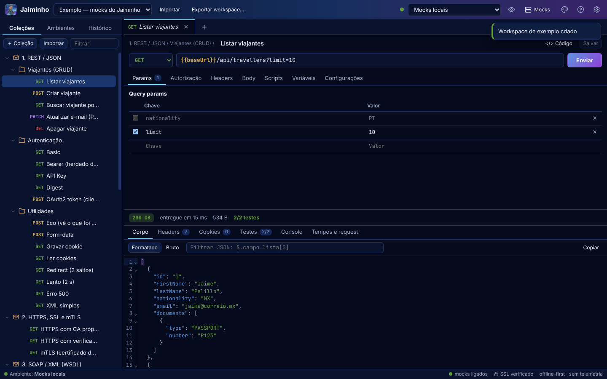
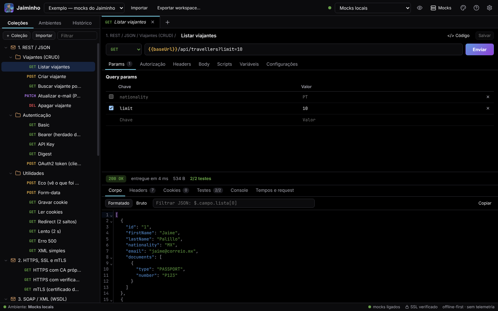
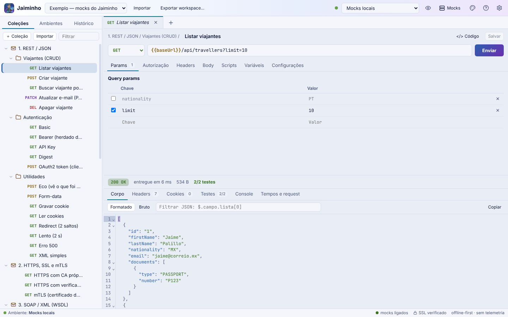
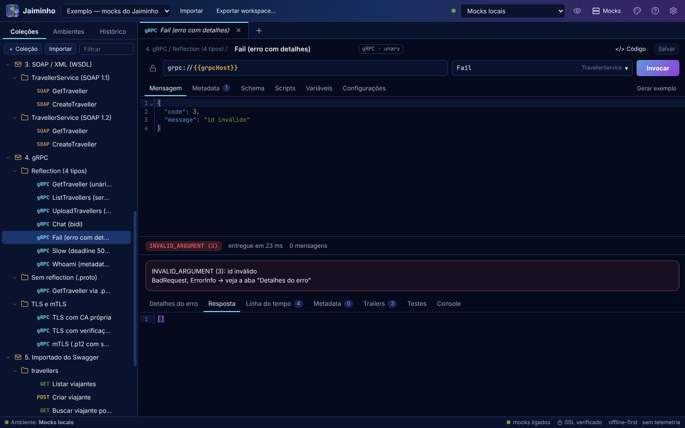

<p align="center"></p>

<h1 align="center">Jaiminho</h1>

<p align="center"><b>Cliente de API para desktop, local e offline.</b><br>HTTP/JSON · XML/SOAP · gRPC — sem conta, sem nuvem, sem telemetria.</p>

<p align="center">Open source · Windows (instalador e portátil) · Electron + motor open source do Postman</p>

---

## Por que o Jaiminho existe

O Postman é ótimo, mas hoje ele pede conta, sincroniza seus dados com a nuvem deles e muita coisa só funciona com internet. Isso é um problema real para quem trabalha:

- **dentro de uma VPN ou rede fechada**, onde o app não alcança a nuvem do fabricante;
- **com APIs internas e dados sensíveis**, que não deveriam sair do computador (URLs, tokens, payloads, certificados);
- **com gRPC, SOAP e mTLS no dia a dia**, e não só com REST/JSON.

O Jaiminho nasceu para resolver isso: **uma única ferramenta instalável, como o Postman e o Bruno, que roda 100% local**, entende HTTP/JSON, XML/SOAP e gRPC como cidadãos de primeira classe e guarda tudo em **arquivos de texto** que você pode versionar no git ou compartilhar numa pasta de rede.

O nome é uma homenagem ao carteiro do seriado *Chaves*: quem leva a mensagem até o destino e traz a resposta de volta.

### Princípios

| Princípio | Na prática |
|---|---|
| **Local e offline** | Nenhuma chamada de rede além das que *você* faz. Sem conta, sem telemetria, sem CDN: a interface não consegue nem carregar recurso remoto (CSP bloqueia). Há um teste automatizado que garante isso. |
| **Seus dados são arquivos** | O workspace é uma pasta com YAML legível. Dá para abrir no editor, fazer diff, code review, versionar e mesclar. |
| **Segredos não viajam** | Valores marcados como *Segredo* ficam cifrados no seu PC (DPAPI no Windows) e **nunca** vão para o workspace, para o export ou para o git. |
| **Compatível com o Postman** | Importa coleções e ambientes do Postman; roda os scripts `pm.*` com o próprio motor open source do Postman. |
| **gRPC de verdade** | Reflection, `.proto`, protoset, os 4 tipos de chamada, mTLS e erros ricos decodificados. |
| **Rápido e leve de usar** | Árvore com milhares de requests, respostas de dezenas de MB e streams longos sem travar a interface (medido em testes). |

## Instalar (Windows)

Baixe nos **Releases** do repositório:

- `Jaiminho-Setup-1.0.0.exe`: instalador. Não pede administrador e deixa escolher a pasta.
- `Jaiminho-1.0.0-portatil.exe`: executável único, roda sem instalar.

Os dois levam tudo dentro (motor, mocks, fontes) e funcionam offline. **Os binários ainda não são assinados**, então o SmartScreen avisa na primeira execução: *Mais informações → Executar assim mesmo*.

Na tela inicial, **Workspace de exemplo** cria coleções REST, HTTPS/mTLS, SOAP, gRPC e Swagger já apontando para servidores *mock* embutidos. É a forma mais rápida de conhecer o app.

## Capturas de tela

| Padrão | Preto | Branco |
|---|---|---|
|  |  |  |



## O que faz

| Área | Recursos |
|---|---|
| **HTTP/JSON** | Métodos, params e path variables (`:id`), headers, body (JSON, XML, texto, urlencoded, form-data com arquivo, binário, GraphQL), cookies, redirects, timeout e tempos (DNS, TCP, TLS, 1º byte). Resposta formatada ou bruta, busca, headers, cookies, testes, console e linha do tempo. |
| **Auth** | Basic, Bearer, API Key, Digest, OAuth 1/2 (busca o token sozinho), NTLM, AWS, Hawk, JWT; herança coleção → pasta → request. |
| **Variáveis** | Precedência global < coleção < ambiente < pasta < request < dados < local; valor compartilhado × valor local; segredos cifrados fora do workspace; 118 variáveis dinâmicas do Postman (`{{$guid}}`, `{{$timestamp}}`…); `{{$env.X}}`; destaque na URL e painel de variáveis efetivas (Ctrl+E). |
| **Scripts** | API `pm.*` do Postman: `pm.test`, `pm.expect`, `pm.environment`, `pm.variables`, `pm.sendRequest`, `pm.cookies`… Scripts herdados de coleção e pasta. |
| **SSL / mTLS** | Desligar a verificação (global ou por request), CAs próprias e as do sistema, mTLS por host (PEM ou PFX/P12 com senha), para HTTP **e** gRPC. |
| **XML / SOAP** | Importar WSDL 1.1 e 1.2, envelope de exemplo, SOAPAction automático, validação XSD, XPath, formatação que preserva CDATA e comentários, SOAP Fault legível. |
| **gRPC** | Reflection v1/v1alpha, `.proto` com imports, protoset, "congelar schema"; unário, server streaming, client streaming e bidi; metadata; deadline; TLS/mTLS; `grpc-status-details-bin` decodificado; scripts `beforeInvoke`, `onIncomingMessage` e `afterResponse`; export grpcurl. |
| **Importar** | Colar um **cURL** (bash, cmd ou PowerShell) direto na barra de URL cria a request; grpcurl; coleção, ambiente e backup do Postman; **Swagger/OpenAPI** 2 e 3 por URL (inclui Swagger UI e springdoc), arquivo ou YAML, com sincronização, e também a **página do Swagger UI salva como HTML** (baixa a especificação original se a rede deixar; senão reconstrói as requests pela página); WSDL; bundle `.jaiminho`. |
| **Exportar** | cURL, grpcurl, código (Java OkHttp, PowerShell, Python, JavaScript…), coleção e ambiente Postman v2.1 e bundle `.jaiminho` **sem segredos**. |
| **Time** | Workspace em YAML (git ou pasta de rede), Collection Runner com CSV/JSON e relatório JUnit, histórico local por dia, cookie jar. |
| **Mocks embutidos** | Servidores locais de REST, XML, SOAP + WSDL, Swagger, HTTPS, mTLS e gRPC (com e sem reflection, com TLS e mTLS) para testar o próprio app. |
| **Aparência e ajuda** | Três temas (Padrão, Preto, Branco); tutoriais offline em **F1** (15 tópicos, com busca sem acento e um guia "Vindo do Postman"); atalhos de teclado e navegação completa por teclado na árvore. |

## Como funciona o workspace

Um workspace é uma pasta. Exemplo:

```
meu-workspace/                     # a pasta que você compartilha ou versiona
  jaiminho.yaml                    # manifesto: nome, proxy, certificados por host
  environments/
    qua.env.yaml                   # valores compartilhados (segredos ficam de fora)
  collections/
    pagamentos/
      _collection.yaml             # variáveis, auth e scripts da coleção
      pedidos/
        010-criar.req.yaml         # uma request = um arquivo
        010-criar.body.json        # body grande vai para arquivo irmão
  protos/  wsdl/  data/            # .proto, WSDL/XSD importados e CSV/JSON do runner
  .jaiminho/                       # SÓ LOCAL (histórico, cookies, segredos cifrados): fora do git
```

- Arquivos pequenos, com ordem de chaves fixa e prefixo numérico para ordenar a árvore, pensados para gerar diffs limpos no git.
- Se um YAML estiver corrompido (por exemplo, conflito de merge), o app **ignora esse arquivo e avisa qual é**, em vez de se recusar a abrir o workspace.
- Para compartilhar sem git: **Exportar workspace** gera um `.jaiminho` sem segredos; quem recebe preenche os próprios valores.

Detalhes em [`docs/projeto/workspace_e_variaveis.md`](docs/projeto/workspace_e_variaveis.md).

## Arquitetura em uma olhada

```
┌────────────────────── Electron ──────────────────────┐
│  renderer (React 18 + CodeMirror 6, sandbox, CSP)    │
│        │  contextBridge (preload)                    │
│  main ─┴─ carteiro (utility process) ── engine       │
│                                          ├ HTTP/SOAP: postman-runtime + sandbox
│                                          ├ gRPC: @grpc/grpc-js + protobufjs (reflection própria)
│                                          └ workspace YAML, variáveis, import/export
└──────────────────────────────────────────────────────┘
```

- O **motor** (`packages/engine`) é independente da interface e pode ser usado em testes e scripts.
- As requests rodam num processo separado (*carteiro*), então uma resposta gigante ou um script pesado não congela a janela.
- Scripts HTTP rodam no sandbox do `postman-sandbox`, com um **pool de contextos** reaproveitados para não pagar ~250 ms de inicialização a cada envio. Scripts gRPC rodam num sandbox próprio, sem `eval` e sem protótipos do host.

Documentos de desenho: [arquitetura](docs/projeto/arquitetura.md) · [gRPC](docs/projeto/grpc.md) · [workspace e variáveis](docs/projeto/workspace_e_variaveis.md) · [importação e exportação](docs/projeto/importacao_exportacao.md) · [roadmap](docs/projeto/roadmap.md).

## Qualidade

O projeto tem uma bateria de testes que roda contra os mocks embutidos:

| Suíte | O que cobre |
|---|---|
| `packages/engine` (`npm test`) | 42 testes unitários e de integração do motor |
| `qa/01` a `qa/09` | variáveis e scripts, HTTP (auth, cookies, redirect, gzip, cancelamento), TLS/mTLS, gRPC (4 tipos, reflection, `.proto`), import/export, workspace em disco (nomes reservados do Windows, YAML corrompido), offline, XML/SOAP, performance do motor |
| `apps/desktop/e2e/flow.js` | fluxo completo na interface, em desenvolvimento e no build empacotado |
| `qa/e2e-extra.js` | temas, ajuda, segredos, runner, cancelamento, fechar com aba suja |
| `qa/perf-ui.js` | travamentos da interface (3.000 requests, resposta de 20 MB, stream de 5.000 mensagens) |

Relatórios: [`qa/RELATORIO_QA.md`](qa/RELATORIO_QA.md) e [`uxreview/`](uxreview/).

## Desenvolvimento

Requisitos: Node.js 20+ e npm.

```bash
npm install                          # na raiz (npm workspaces)
npm test                             # testes do motor
npm run mocks                        # sobe os mocks (4010, 4443, 4444, 50051–50053)
npm run dev                          # build da UI + abre o app
bash qa/run-all.sh                   # QA completo
cd apps/desktop && xvfb-run -a node e2e/flow.js   # e2e (Linux, headless)
node scripts/package-win.js          # gera instalador e portátil em release/ (no Linux precisa do wine)
```

### Estrutura

```
packages/engine   motor: workspace YAML, variáveis, HTTP/SOAP, gRPC, import/export
packages/mocks    servidores mock (REST, XML, SOAP, Swagger, HTTPS, mTLS, gRPC)
apps/desktop      app Electron: main, carteiro, preload, renderer React
docs/             desenho e pesquisa
branding/         mascote, ícones e identidade visual
qa/, uxreview/    suítes, relatórios e capturas de QA e UI/UX
```

## Roadmap

- Validar em mais ambientes Windows reais (CAs corporativas, proxy PAC) e assinar os binários.
- CLI para rodar coleções em pipelines (reaproveitando o motor).
- Sincronização de Swagger com diff completo.
- "Correio": compartilhar workspaces na rede local, sem servidor.
- Builds para macOS e Linux.

Veja [`docs/projeto/roadmap.md`](docs/projeto/roadmap.md).

## Contribuindo

Contribuições são bem-vindas: issues, correções, novos testes e ideias.

1. Faça um fork e crie uma branch.
2. Rode `npm test` e `bash qa/run-all.sh` antes de abrir o PR.
3. Mantenha a regra central: **nada de internet em runtime** (sem CDN, sem telemetria) e **segredos nunca no workspace**.
4. Textos da interface em português do Brasil.

## Créditos e licença

O Jaiminho não copia código do Postman. Ele **usa as bibliotecas open source** publicadas por eles (`postman-runtime`, `postman-collection`, `postman-sandbox`, `openapi-to-postmanv2`, `postman-code-generators`, `curl-to-postmanv2`, também sob Apache-2.0) e se apoia em `@grpc/grpc-js`, `protobufjs`, Electron, React e CodeMirror. Postman é marca de seus donos; este projeto não é afiliado a eles.

O código é distribuído sob a licença **Apache-2.0** (arquivo [`LICENSE`](LICENSE) e [`NOTICE`](NOTICE)). A arte do mascote em `branding/` é do autor do projeto e **não** está coberta pela licença Apache-2.0: todos os direitos reservados, uso apenas com o aviso de origem.

*Jaiminho é um projeto independente, sem relação com os detentores dos direitos do seriado que o inspirou.*
