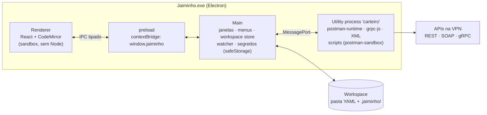
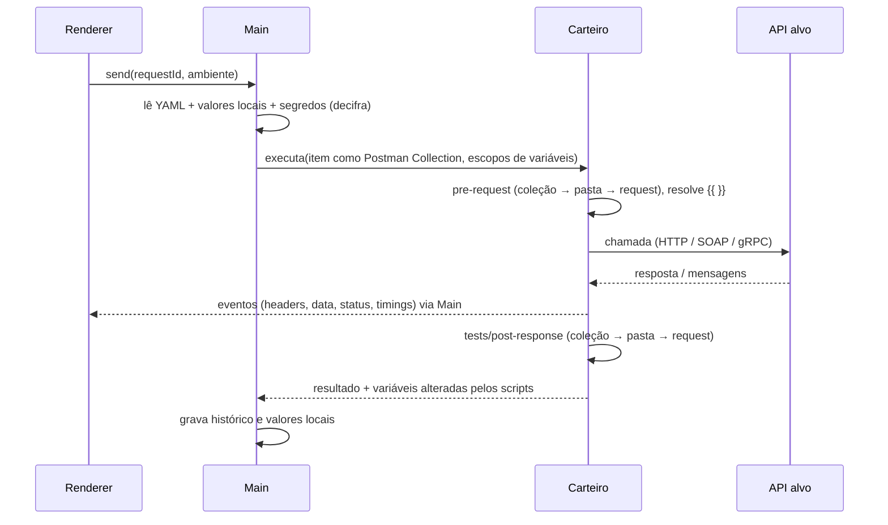

# Jaiminho — Arquitetura

> Cliente de API desktop, local e offline (HTTP/JSON, XML/SOAP, gRPC), no mesmo modelo do Postman e do Bruno.
> Desenho v0.2 · 2026-10-23 · autor: CLAUDE · status: ativo (stack decidida)

Documentos irmãos (mesma pasta): `grpc.md` · `workspace_e_variaveis.md` · `importacao_exportacao.md` · `roadmap.md`
Pesquisa: `..\ia\engenharia_reversa_postman.md` · `..\ia\pesquisa_ferramentas.md`

---

## 1. Requisitos que mandam no desenho

| # | Requisito (do autor) | Consequência no desenho |
|---|---|---|
| R1 | Requests em JSON, XML e gRPC | 3 executores atrás de uma interface única no processo de rede |
| R2 | Simples como o Postman, **um app só** (sem navegador) | app desktop Electron com instalador, igual Postman e Bruno; UI de 3 painéis, atalhos iguais |
| R3 | Variáveis e ambientes como o Postman | usar o próprio motor open source do Postman (`postman-runtime`, `postman-collection`, `postman-sandbox`): mesmos escopos, mesma precedência, mesmo `pm.*` |
| R4 | Sem internet (VPN) | zero CDN, zero login, zero telemetria, zero auto-update; tudo dentro do instalador |
| R5 | Fácil de partilhar com os amigos | workspace = pasta de YAML (git/pasta de rede) + bundle `.jaiminho` + cURL/grpcurl |
| R6 | Swagger por URL ou arquivo | `openapi-to-postmanv2` (o conversor do próprio Postman) + leitura do `swagger-config` do Swagger UI |
| R7 | gRPC muito bom | mesma base do Postman: `grpc-js` + `protobufjs` + `proto-loader` + reflection |

## 2. Stack escolhida

**Electron + React (JavaScript), com o motor open source do Postman.** (Implementado na v0.1.0.)

Por quê (detalhe em `Jaiminho_dec_2026-10-23_stack`):
1. É a arquitetura que Postman e Bruno usam. O REA no Postman 12.25.6 instalado confirmou: Electron, Node 24, gRPC com `@postman/grpc-js`, `@postman/protobufjs`, `@postman/proto-loader`, `@postman/grpc-reflection-js`, motor `postman-runtime` 7.56 e `postman-collection` 5.3.
2. O motor do Postman é **Apache-2.0**: `postman-runtime`, `postman-collection`, `postman-sandbox`, `openapi-to-postmanv2`, `postman-code-generators`, `curl-to-postmanv2`, `newman`. Usar como biblioteca dá compatibilidade com o Postman quase de graça (variáveis, 13 tipos de auth, cookies, certificados, scripts `pm.*`, import de Swagger, export de código).
3. gRPC em Node não precisa de `protoc`: o `protobufjs` lê `.proto` em JS puro.
4. Um instalador `.exe` (NSIS) ou portátil, sem JRE nem navegador.

| Camada | Tecnologia | Licença |
|---|---|---|
| Shell desktop | Electron 38 + Vite (renderer) | MIT |
| UI | React 18 (JavaScript), store próprio (useSyncExternalStore), CodeMirror 6 (embutido, sem CDN; trocado do Monaco por ser mais leve e sem web workers) | MIT |
| Motor HTTP/SOAP | `postman-runtime` + `postman-collection` + `postman-sandbox` | Apache-2.0 |
| gRPC | `@grpc/grpc-js`, `protobufjs`, `@grpc/proto-loader`, `grpc-js-reflection-client` | Apache-2.0 / BSD-3 / MIT |
| XML | `fast-xml-parser`, `@xmldom/xmldom` + `xpath`, `xmllint-wasm` (XSD, sem binário nativo), `soap` (só leitura de WSDL) | MIT |
| Import/export | `openapi-to-postmanv2`, `curl-to-postmanv2`, `postman-code-generators` | Apache-2.0 |
| Arquivos | `yaml`, `@parcel/watcher` (o mesmo do Postman) | ISC / MIT |
| Segredos | `safeStorage` do Electron (DPAPI no Windows) | MIT |
| Empacotamento | `electron-builder`: NSIS + portable `.exe` (Windows), AppImage/deb, dmg | MIT |
| CLI | `jaiminho` (Node, reusa o motor) | — |

## 3. Processos (igual ao Postman: a UI nunca chama a rede)



- **Renderer:** só UI. `contextIsolation`, `sandbox`, `nodeIntegration: false`, CSP sem origem remota, navegação externa bloqueada.
- **Main:** dono do disco (lê/grava YAML, observa a pasta, cifra segredos). Nunca executa request.
- **Utility process "carteiro"** (`utilityProcess.fork`): resolve variáveis, roda scripts, executa HTTP/SOAP/gRPC e manda eventos. Se travar ou cair, o app continua e o processo é recriado. O Postman faz o mesmo com `AgentWorker.js` / `ExecutionProcess.js`.

## 4. Estrutura do repositório (monorepo npm workspaces)

```
jaiminho/
├─ apps/
│  ├─ desktop/            Electron: main/, preload/, renderer/ (React)
│  ├─ web/                servidor Node + shim do navegador (versão web e Docker)
│  └─ cli/                jaiminho run|import|export
├─ packages/
│  ├─ model/              tipos do workspace (YAML) + conversão YAML ⇄ Postman Collection v2.1
│  ├─ store/              leitura/escrita YAML, ids UUIDv7, watcher, merge, bundle .jaiminho
│  ├─ engine-http/        wrapper do postman-runtime (HTTP e SOAP), timings, certificados
│  ├─ engine-grpc/        reflection, proto, protoset, chamadas, sessões de streaming, exemplos
│  ├─ xml/                WSDL → requests, envelopes, XSD, XPath
│  ├─ scripting/          postman-sandbox + hooks gRPC (beforeInvoke, onIncomingMessage, afterResponse)
│  ├─ io/                 importadores/exportadores (OpenAPI, Postman, cURL, grpcurl, WSDL, Insomnia, Bruno, HAR)
│  └─ ipc-contract/       tipos dos canais IPC (compartilhados por main, preload, renderer e carteiro)
└─ build/                 ícones, electron-builder.yml, scripts
```

## 5. Ciclo de um envio



O HTTP e o SOAP passam pelo `postman-runtime` (como o Newman). O workspace YAML é convertido em memória para o formato Collection v2.1 que o motor entende; nada é gravado nesse formato.

## 6. Contrato IPC (resumo; tipos em `packages/ipc-contract`)

| Canal | Direção | Para quê |
|---|---|---|
| `workspace:open` / `:tree` / `:watch` | UI → Main | abrir pasta, árvore, avisos de mudança externa |
| `item:get` / `:save` / `:create` / `:move` / `:delete` | UI → Main | edição (Main grava YAML) |
| `env:list` / `:save` / `:select` | UI → Main | ambientes |
| `secret:set` / `:list-missing` | UI → Main | segredos (valor nunca volta para a UI sem pedido explícito) |
| `exec:send` / `:cancel` | UI → Carteiro | HTTP/SOAP/gRPC unário |
| `grpc:describe` / `:sample` / `:start` / `:write` / `:end` / `:cancel` | UI → Carteiro | gRPC e streaming |
| `exec:event` | Carteiro → UI | `request-sent`, `response-header`, `response-data`, `status`, `error`, `test-result`, `done` |
| `io:import-preview` / `:import-commit` / `:export` | UI → Main/Carteiro | importação e exportação |
| `codegen:render` | UI → Carteiro | cURL, grpcurl, Java, PowerShell... |
| `runner:start` / `:event` | UI ↔ Carteiro | Collection Runner |

Nomes dos eventos gRPC seguem os do Postman (`sent-request-header`, `sent-request-data`, `received-response-header`, `received-response-data`, `status`, `error`, `close`), vistos no REA.

## 7. UI

```
┌───────────────────────────────────────────────────────────────────────────┐
│ ✉ Jaiminho  Workspace: Exemplo ▾                     Ambiente: QUA ▾  👁  ⚙ │
├──────────────┬────────────────────────────────────────────────────────────┤
│ Coleções     │ [GET ▾] {{baseUrl}}/travellers/{{id}}               [Enviar] │
│ ▸ Orders API    │ Params · Auth · Headers · Body · Scripts · Settings        │
│   ▸ Viajante │ ┌────────────────────────────────────────────────────────┐ │
│ ▸ Gateway    │ │ Monaco                                                 │ │
│ Ambientes    │ └────────────────────────────────────────────────────────┘ │
│ Histórico    ├────────────────────────────────────────────────────────────┤
│ Protos/WSDL  │ 200 OK · 143 ms · 2,1 KB    Body · Headers · Testes · Timeline│
└──────────────┴────────────────────────────────────────────────────────────┘
```
- Abas, `Ctrl+Enter` envia, `Ctrl+S` salva, `Ctrl+L` foca a URL, 👁 mostra as variáveis efetivas e de qual escopo vêm.
- `{{var}}` com hover (valor + escopo); não resolvida fica vermelha.
- Colar cURL na barra de URL importa o request.
- Resposta: Pretty/Raw/Preview, busca, JSONPath/XPath ao vivo, salvar como exemplo, tempos (DNS, TCP, TLS, TTFB, download).
- Três temas (Padrão azul-marinho, Preto puro, Branco) com a paleta de `branding\identidade.md`; troca pelo botão da paleta ou em Configurações → Este PC; valores antigos `dark`/`light` migram sozinhos.
- Ajuda embutida (F1): 13 tópicos offline em `renderer/src/components/HelpModal.jsx`, com busca e links contextuais (`HelpLink`).
- Performance: pool de contextos do `postman-sandbox` (`packages/engine/src/sandbox-pool.js`) tira ~230 ms de cada envio; árvore grande (>400 nós) abre só o 1º nível; `React.memo` + `useDeferredValue` na árvore.

## 8. Requisitos não funcionais

| Tema | Meta |
|---|---|
| Offline | instala e envia com a rede externa cortada (teste de aceitação no CI) |
| Início | < 3 s até a janela pronta |
| Memória | < 500 MB com workspace de 1 000 requests |
| Compatibilidade | importar a coleção Postman v2.1 do time e rodar os scripts `pm.*` sem mudança |
| Portabilidade | workspace igual em Windows, Linux e macOS (caminhos relativos, LF) |
| Segredos | nunca em arquivo partilhado, export, cURL exportado ou log |
| Atualização | sem auto-update pela internet; novo instalador por pasta de rede / Teams |

## 9. Riscos

| Risco | Mitigação |
|---|---|
| Electron pesado (~120 MB instalado) | aceitável, igual ao Postman/Bruno; carteiro separado evita travar a UI |
| `postman-runtime` muda API | versão fixa no lockfile; testes de contrato com coleções reais |
| CAs internas da VPN não confiáveis no Node | juntar o trust store do Windows (`tls.getCACertificates('system')` quando o Node do Electron tiver; senão `win-ca`) às CAs do Node, para HTTP e gRPC |
| Proxy/PAC corporativo | `session.resolveProxy` do Electron para descobrir o proxy por URL e passar ao motor; opção manual por workspace |
| `pm.*` em gRPC não coberto pelo `postman-sandbox` open source | implementar os hooks gRPC na camada `scripting` (a confirmar no código do sandbox) |
| Antivírus implicar com `.exe` não assinado | assinar com certificado interno da empresa, se houver; portable como alternativa |

## 10. Versão web e Docker (1.1)

`apps/web` serve o mesmo `renderer/dist` a um navegador. O `server.js` (Node, sem Electron) injeta `client/shim.js`, que implementa `window.jaiminho`: `call` vira `POST /api/call`, eventos chegam por SSE (`/api/events`), diálogos viram janelas na página, o seletor de pastas/arquivos lista o **servidor** (limitado a `JAIMINHO_ROOT`) e aceita envio de arquivos, e "Salvar como" gera o arquivo no servidor e o navegador baixa.

Cada usuário tem um processo `carteiro-host.js` (o mesmo `carteiro.js` do desktop, com `process.parentPort` adaptado sobre `process.send`), desligado após 30 min sem uso. O motor não muda; só o transporte.

| Ameaça | Mitigação |
|---|---|
| Acesso não autorizado | HTTP Basic obrigatório; senha gerada na 1ª subida; bloqueio de IP após 10 erros em 5 min |
| CSRF | POST exige `x-jaiminho-web: 1` e Origin igual; GET rejeita `sec-fetch-site: cross-site` |
| Leitura/escrita fora da área | argumentos `dir`/`file`/`dataFile` e navegação do seletor resolvidos (inclui symlink) e confinados a `JAIMINHO_ROOT` |
| Vazamento entre usuários | motor, configurações, uploads e downloads por usuário |
| Segredos em repouso | cifrados com `secrets.key` (0600) ou `JAIMINHO_SECRET_KEY` |
| Uso do servidor como "máquina de requests" | risco aceito para quem autentica; documentado; usar HTTPS e rede restrita |

Docker: build multi-estágio (UI compilada no 1º, só dependências de produção no 2º), usuário `node`, volume `/data`, `HEALTHCHECK /healthz`. Detalhes de uso em `docs/web-docker.md`.
