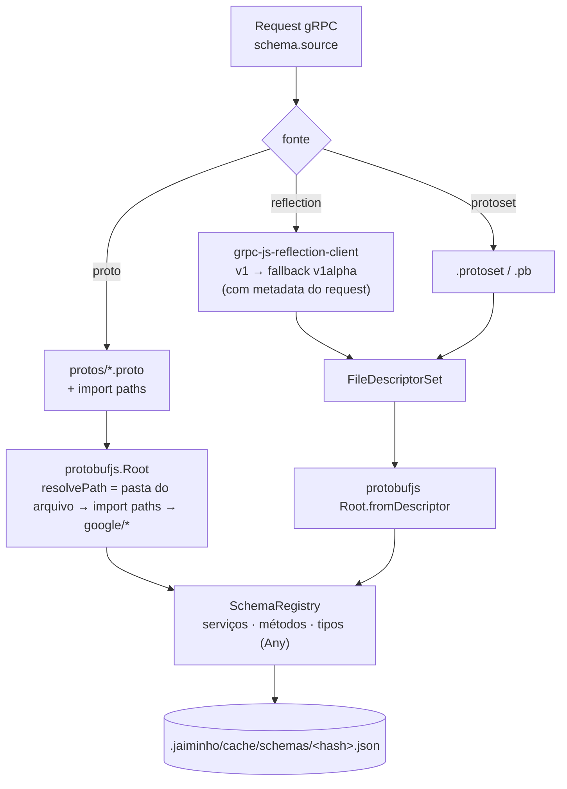
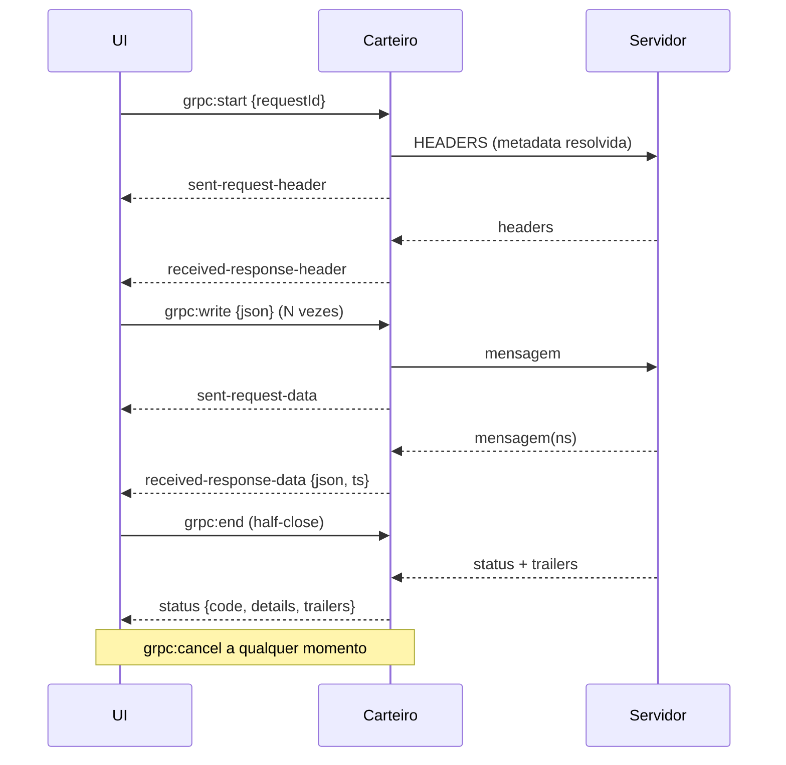

# Jaiminho — gRPC

> Desenho do executor gRPC · v0.2 · 2026-10-23 · autor: CLAUDE · status: ativo

## 1. Paridade e o que vai além

| Função | Postman 12.25.6 (REA) | Bruno | Kreya | Jaiminho |
|---|---|---|---|---|
| Base | `@postman/grpc-js`, `@postman/protobufjs`, `@postman/proto-loader`, `@postman/grpc-reflection-js` | `@grpc/grpc-js`, `@grpc/proto-loader`, `grpc-js-reflection-client` | .NET | `@grpc/grpc-js`, `protobufjs`, `@grpc/proto-loader`, `grpc-js-reflection-client` |
| Onde roda | worker do runtime (`AgentWorker.js`) | processo principal | — | utility process "carteiro" |
| Reflection v1 e v1alpha | sim (as duas strings no bundle) | v1 → v1alpha | sim, contínua | v1 → v1alpha, com metadata, com cache |
| `.proto` com imports | sim (Protobuf API, import paths) | sim | observa a pasta | pasta `protos/` + import paths |
| Protoset | não visto | não | sim | sim + "congelar schema" |
| 4 tipos de chamada | `unary`, `server-stream`, `client-stream`, `bidi` | sim | sim | sim |
| Metadata, trailers, status | sim | sim | sim | sim |
| `grpc-status-details-bin` | lido pelo runtime | — | — | decodificado e mostrado |
| TLS / mTLS / `ssl_target_name_override` | sim | sim | sim | sim + CAs do Windows |
| Proxy HTTP CONNECT (`grpc.http_connect_target`) | sim | — | — | sim |
| Scripts | `beforeInvoke`, `onIncomingMessage`, `afterResponse` | sim | sim | os mesmos 3 hooks |
| Mock server | sim (`application/grpc`, `grpc-web`) | — | — | fase 4 |
| Exportar grpcurl | não visto | sim | importa | exporta e importa |

## 2. Fontes de schema



- **Reflection:** `ListServices` → `FileContainingSymbol` por serviço → dependências até fechar o grafo. Metadata do request vai junto (servidor com auth recusa reflection anônima; o Bruno faz o mesmo).
- **`.proto`:** `protobufjs` em JS puro, sem `protoc`. `resolvePath` procura na pasta do arquivo, depois nos import paths do workspace (na ordem), depois nos `google/protobuf/*` embutidos. Erro de sintaxe aparece com arquivo:linha.
- **Congelar schema:** salva a reflection como `protos/_frozen/<host>.protoset` no workspace. O colega sem acesso ao servidor, ou um ambiente com reflection desligada (QUA/PRD), usa o mesmo schema.
- Cache por hash do conteúdo; o watcher invalida quando um `.proto` muda.

## 3. Invocação dinâmica

```ts
// esboço (packages/engine-grpc)
const def = protoLoader.fromJSON(root.toJSON(), { keepCase: true, longs: String, enums: String, defaults: true, oneofs: true });
const svc = grpc.loadPackageDefinition(def)[pkg][service] as grpc.ServiceClientConstructor;
const client = new svc(target, credentials, channelOptions);
const md = toMetadata(resolvedMetadata);
switch (kind) {
  case 'unary':         client[method](msg, md, { deadline }, cb); break;
  case 'server-stream': stream = client[method](msg, md, { deadline }); break;
  case 'client-stream': stream = client[method](md, { deadline }, cb); break;
  case 'bidi':          stream = client[method](md, { deadline }); break;
}
// stream.on('metadata' | 'data' | 'status' | 'error' | 'end') → eventos para a UI
```

- JSON ↔ protobuf: `Type.fromObject` / `toObject` com `longs: String`, `enums: String`, `defaults` configurável (o gRPC omite zeros, o que confunde).
- Campo que não existe no schema é erro **antes** de enviar, com o caminho do campo (`Type.verify`).
- `Any`, `Timestamp`, `Duration`, `Struct`, `Value`, wrappers: tratamento JSON igual ao `JsonFormat` do Java (o runtime do Postman tem o mesmo tratamento, visto no bundle).

## 4. Streaming: sessão e eventos



Nomes dos eventos iguais aos do Postman (REA): `sent-request-header`, `sent-request-data`, `received-response-header`, `received-response-data`, `status`, `error`, `close`, `transient-error`.

UI: linha do tempo ↑ enviadas / ↓ recebidas com hora em ms, tamanho, busca e filtro; "reenviar esta mensagem"; contador; exportar timeline em JSON. Eventos em lote a cada 50 ms para aguentar milhares de mensagens.

## 5. Conexão, TLS e opções

| Opção | Padrão | Nota |
|---|---|---|
| Transporte | plaintext em `grpc://`, TLS em `grpcs://` ou porta 443 | cadeado na URL, como no Postman |
| CA | CAs do Node **+ CAs do Windows** | resolve as CAs internas da VPN sem configurar |
| CA extra / mTLS | PEM ou PKCS#12 por host (`jaiminho.yaml`); senha nos segredos | `credentials.createSsl(ca, key, cert)` |
| `:authority` / SNI | vazio | `grpc.ssl_target_name_override` + `grpc.default_authority` |
| Proxy | do sistema/PAC | `grpc.http_connect_target` (o Postman usa isso) |
| Deadline | 30 s unário / sem limite em streaming | |
| Tamanho máx. | 64 MB | `grpc.max_receive_message_length` / `max_send` |
| Keepalive | desligado | `grpc.keepalive_time_ms` |
| Compressão | nenhuma / gzip | |
| Canal | reusado por (alvo, TLS, authority, opções); fecha ocioso em 5 min | botão "nova conexão" |

## 6. Erros legíveis

- Status com nome e número (`UNAVAILABLE (14)`), mensagem e **detalhes de `grpc-status-details-bin`** decodificados como `google.rpc.Status` (`ErrorInfo`, `BadRequest`, `RetryInfo`, `DebugInfo`... embutidos).
- Transporte traduzido: certificado (qual CA faltou, nome que não bate), DNS, conexão recusada, resposta HTTP/1.1 (proxy no meio), deadline.

## 7. Mensagem de exemplo

Gerada do schema: escalares por tipo e nome (`id`, `email`, `date`...), enum = primeiro valor não zero, `repeated` com 1 item, `map` com 1 entrada, `oneof` = primeiro ramo + comentário dos outros, WKT (`Timestamp` = agora, `Duration` = `"1s"`), recursão até 3 níveis. O Monaco recebe um JSON Schema derivado do tipo para autocomplete e validação ao digitar.

## 8. Scripts (mesmos hooks do Postman)

| Hook | Quando | Uso |
|---|---|---|
| `beforeInvoke` | antes de abrir a chamada | montar metadata, token, variáveis |
| `onIncomingMessage` | a cada mensagem recebida | testes por mensagem em streaming |
| `afterResponse` | depois do status final | testes, guardar variáveis |

```js
pm.test("OK", () => pm.expect(pm.response.statusCode).to.eql(0));
const msgs = pm.response.messages.all();
pm.environment.set("travellerId", msgs[0].data.id);
```

## 9. grpcurl

Exporta (bash e PowerShell; `-proto`/`-import-path` ou `-protoset` conforme a fonte):
```bash
grpcurl -plaintext -H 'authorization: Bearer ...' -d @ localhost:9090 demo.v1.TravellerService/GetTraveller <<'EOM'
{ "id": "123" }
EOM
```
Importa o caminho inverso (colar o comando cria a request).

## 10. Testes de aceitação

1. Servidor de teste (`packages/engine-grpc/test`) com os 4 tipos, reflection v1 e v1alpha, TLS e mTLS.
2. `.proto` com import transitivo em pasta irmã, `google/protobuf/timestamp.proto`, `oneof`, `map`.
3. `BadRequest` em `grpc-status-details-bin` aparece decodificado.
4. Reflection que exige metadata.
5. Bidi com 10 000 mensagens sem travar a UI.
6. Um gateway gRPC real do seu ambiente como teste de ponta a ponta.
