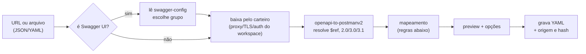

# Jaiminho — Importação e exportação

> v0.2 · 2026-10-23 · autor: CLAUDE · status: ativo

## 1. Matriz

| Formato | Importa | Exporta | Fase | Biblioteca / nota |
|---|---|---|---|---|
| Swagger 2.0 / OpenAPI 3.0 / 3.1 (URL ou arquivo, JSON/YAML) | sim | fase 3 | 1 | `openapi-to-postmanv2` (o conversor do próprio Postman, Apache-2.0) → Collection v2.1 → YAML |
| URL do Swagger UI / springdoc | sim | — | 1 | lê `/v3/api-docs/swagger-config` e oferece os grupos |
| cURL (bash, cmd, PowerShell) | sim (colar na URL) | sim | 1 | import: `curl-to-postmanv2`; export: `postman-code-generators` |
| Postman Collection v2.0/v2.1 | sim | sim | 1 | formato público (schema.getpostman.com); scripts `pm.*` passam quase sem mudança |
| Postman Environment / Globals | sim | sim | 1 | |
| Postman data dump (backup completo) | sim | — | 2 | vários arquivos de uma vez |
| WSDL 1.1 (+ XSD) | sim | — | 2 | `soap` (MIT, só para ler o WSDL) + gerador de envelope próprio a partir do XSD |
| `.proto` / protoset | sim | sim | 2 | ver `grpc.md` |
| grpcurl | sim | sim | 2 | |
| Insomnia v4 (JSON/YAML) | sim | — | 3 | |
| Bruno (`.bru` / coleção) | sim | — | 3 | |
| HAR (DevTools) | sim | — | 3 | vira coleção com as chamadas gravadas |
| Bundle `.jaiminho` | sim | sim | 1 | formato próprio de troca entre amigos |
| Código (Java HttpClient, Spring RestClient, fetch, Python requests, HTTPie, PowerShell `Invoke-RestMethod`) | — | sim | 2 | `postman-code-generators` (Apache-2.0; tem Java OkHttp/Unirest, PowerShell, Python, Node...) + Spring `RestClient` próprio |

Todo import passa por **preview**: árvore do que vai entrar, conflitos (mesmo id/nome), e um relatório do que não foi convertido (ex.: script com `pm.vault`, auth não suportada). Nada é gravado antes de "Confirmar".

## 2. Swagger / OpenAPI → coleção



Por que o download passa pelo carteiro: o Swagger está dentro da VPN e às vezes exige token/certificado; o carteiro usa o mesmo proxy, trust store e auth configurados no workspace.

### Regras de mapeamento

| OpenAPI | Jaiminho |
|---|---|
| `info.title` / `version` | nome da coleção / variável `apiVersion` |
| `servers[]` (+ `variables`) | variável de coleção `baseUrl` = primeiro server; opção "criar um ambiente por server" |
| `tags` | pastas (opção: agrupar por path em vez de tag) |
| operação | request; nome = `summary` → `operationId` → `MÉTODO /path` |
| `parameters` in path | `{{nome}}` na URL + variável da request com `example`/`default` |
| `parameters` in query | params; obrigatórios ligados, opcionais desligados |
| `parameters` in header/cookie | headers / cookies |
| `requestBody` | body no 1º content type (JSON > XML > form > multipart); valor = `example` → `examples` → gerado do schema |
| `responses` | exemplos salvos (status, headers, body de exemplo) |
| `securitySchemes` + `security` | auth da coleção (bearer, basic, apiKey, oauth2 client credentials/password/authcode+PKCE) com `inherit` nas requests |
| `deprecated` | request marcada (riscada na árvore) |
| `x-` extensions | ignoradas e listadas no relatório |

Gerador de exemplo a partir do schema: respeita `required`, `enum` (primeiro valor), `format` (`date-time` → agora, `uuid` → `{{$guid}}`, `email`...), `oneOf/anyOf` (primeiro + comentário), `allOf` (merge), `readOnly` fora do body, profundidade máx. 5 e corte de ciclos.

### Reimportar / sincronizar

O `openapi-to-postmanv2` já tem a parte de sincronização spec → coleção (`libV2/SpecificationCollectionSyncing`, vista no REA); o Jaiminho usa esse caminho. A coleção guarda a origem:
```yaml
origin: { type: openapi, url: "https://api-qua.interno/v3/api-docs", sha256: "…", importedAt: 2026-10-23T19:00:00Z }
```
"Atualizar do Swagger" baixa de novo e mostra o diff por operação (chave = `operationId`, senão `MÉTODO path`): **novas**, **removidas** (oferece mover para pasta `_removidas`), **alteradas** (params/body/respostas). Edições feitas à mão no request (scripts, valores, headers extras) são preservadas; só o que veio do contrato é atualizado.

## 3. WSDL → coleção SOAP

- Uma pasta por `service`/`port`, uma request por `operation`.
- Envelope de exemplo gerado do XSD (elementos obrigatórios preenchidos, opcionais comentados), `SOAPAction` e versão (1.1/1.2) do binding.
- WSDL e XSD copiados para `wsdl/` do workspace (com os `import`/`include` locais) para validar request e response offline com `xmllint-wasm` (libxml2 em WASM, sem binário nativo).

## 4. Postman → Jaiminho (detalhes que importam)

| Postman | Jaiminho |
|---|---|
| `item` com `item` filho | pasta |
| `request.url` (objeto ou string) | `url` + `params` |
| `body.mode` raw/urlencoded/formdata/file/graphql | mesmos modos |
| `auth` (basic, bearer, apikey, digest, oauth2, ntlm, awsv4, jwt...) | auth equivalente; não suportado → relatório |
| `event[listen=prerequest/test].script.exec` | `scripts.pre` / `scripts.post` |
| `variable` | variáveis de coleção |
| `response[]` | exemplos |
| Environment `values[].type=secret` | segredo (valor vai para `.jaiminho/secrets.enc`, não para o YAML) |
| Request gRPC (exportado em JSON pelo Postman) | `kind: grpc` (formato não documentado: a confirmar com export real) |

Exportar para Postman v2.1 faz o caminho inverso, para quem ainda usa o Postman no time.

## 5. cURL

- **Importar:** reconhece `-X`, `-H`, `-d/--data*`, `--data-urlencode`, `-F`, `-u`, `-k`, `--cert/--key`, `--compressed`, `-b` (cookies), `--url`, continuação de linha `\` (bash), `^` (cmd) e `` ` `` (PowerShell), aspas simples e duplas.
- **Exportar:** 3 sabores (bash, cmd, PowerShell `curl.exe`), com opção "resolver variáveis" ligada ou não. Segredos saem como `{{nome}}` a menos que o usuário marque "revelar".

## 6. Bundle `.jaiminho`

```
meu-workspace.jaiminho  (zip)
├─ manifest.json      { format: "jaiminho-bundle", version: 1, workspace, createdBy, createdAt, contents[], sha256 de cada arquivo }
├─ jaiminho.yaml
├─ collections/…  environments/…  protos/…  wsdl/…  data/…
```
- Sem `.jaiminho/` (segredos, histórico, valores locais).
- Import: verifica hashes, faz preview, merge por `id` (manter meu / usar o deles / manter os dois).
- Pode exportar só uma coleção, só ambientes, ou o workspace inteiro.
