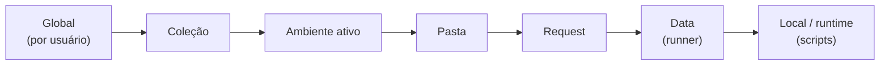
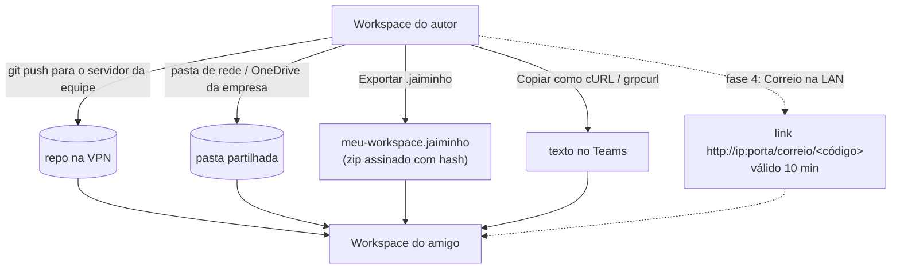

# Jaiminho — Workspace, variáveis e compartilhamento

> v0.2 · 2026-10-23 · autor: CLAUDE · status: ativo

## 1. Workspace = pasta de arquivos

Ideia do Bruno e do Kreya (tudo em arquivo, diff no git), com o modelo de dados do Postman (coleção, pasta, request, exemplo, ambiente). O Postman guarda tudo num banco local + nuvem; é isso que impede o compartilhamento sem internet.

```
meu-workspace/                         ← o workspace (pasta partilhável / repo git)
├─ jaiminho.yaml                   manifesto: nome, formatVersion, importPaths, proxy, certificados por host
├─ environments/
│  ├─ dev.env.yaml
│  ├─ qua.env.yaml
│  └─ prd.env.yaml
├─ collections/
│  └─ orders-api/
│     ├─ _collection.yaml          variáveis, auth, scripts e origem (swagger/wsdl) da coleção
│     ├─ viajante/
│     │  ├─ _folder.yaml           auth/variáveis/scripts da pasta (opcional)
│     │  ├─ 010-criar.req.yaml
│     │  └─ 020-buscar-por-id.req.yaml
│     └─ gateway-grpc/
│        └─ 010-get-traveller.req.yaml
├─ protos/                         .proto com a árvore de pacotes (e _frozen/*.protoset)
├─ wsdl/                           WSDL/XSD importados
├─ data/                           CSV/JSON do runner
├─ .gitignore                      gerado: ignora .jaiminho/
└─ .jaiminho/                      SÓ LOCAL, nunca exportado
   ├─ local-values.yaml            "valor atual" das variáveis (sobrepõe o valor partilhado)
   ├─ secrets.enc                  segredos cifrados com safeStorage do Electron (DPAPI no Windows)
   ├─ history/                     histórico de envios (rotação 30 dias / 5 000 itens)
   ├─ cookies.json
   └─ cache/                       schemas gRPC, descriptors, swagger baixado
```

Regras do formato:
- YAML com ordem de chaves fixa, LF, UTF-8, sem campos vazios → diff limpo.
- Prefixo numérico no nome do arquivo dá a ordem na árvore (`010-`, `020-`: sobra espaço para inserir).
- Body grande (> 4 KB) ou binário vai para arquivo irmão (`010-criar.body.json`, `.body.xml`) referenciado no YAML.
- `formatVersion` no manifesto; o app migra formatos antigos ao abrir (com backup).
- Nada de caminho absoluto: tudo relativo à raiz do workspace.

### Exemplo — request HTTP

```yaml
# collections/orders-api/viajante/020-buscar-por-id.req.yaml
kind: http
name: Buscar viajante por id
method: GET
url: "{{baseUrl}}/travellers/{{travellerId}}"
params:
  - { key: includeHistory, value: "true", enabled: false }
headers:
  - { key: Accept, value: application/json }
auth: { inherit: true }
scripts:
  post: |
    pm.test("200", () => pm.response.to.have.status(200));
    pm.collectionVariables.set("lastTraveller", pm.response.json().id);
examples:
  - name: Encontrado
    status: 200
    bodyFile: 020-buscar-por-id.example-200.json
```

### Exemplo — request SOAP

```yaml
kind: soap
name: Orders
url: "{{ordersUrl}}/Orders"
soap: { version: "1.1", action: "urn:Orders", wsdl: wsdl/orders/Orders.wsdl, operation: Orders }
headers:
  - { key: Content-Type, value: "text/xml; charset=utf-8" }
bodyFile: 010-data-entry.body.xml
validateAgainstXsd: true
```

### Exemplo — request gRPC

```yaml
kind: grpc
name: GetTraveller
url: "grpcs://{{gatewayHost}}:443"
method: demo.v1.TravellerService/GetTraveller
schema: { source: reflection, fallback: protos/_frozen/gateway.protoset }
metadata:
  - { key: authorization, value: "Bearer {{token}}" }
message: |
  { "id": "{{travellerId}}" }
options: { deadlineMs: 30000, showDefaults: true }
```

## 2. Escopos de variáveis

Mesmos escopos e mesma regra do Postman ("vale o escopo mais restrito"), mais `pasta` e `request`, que o Bruno tem e fazem falta no Postman. Na execução, os escopos viram as camadas do `VariableScope` do `postman-collection` (o mesmo objeto que o Postman usa), então a resolução de `{{ }}` e o `pm.variables.get` se comportam igual.


Da esquerda para a direita: cada um sobrepõe o anterior. `Local` ganha de todos.

| Escopo | Onde mora | Vai no export? | Uso típico |
|---|---|---|---|
| Global | `%APPDATA%\Jaiminho\globals.yaml` (pasta `userData` do Electron) | não (opcional) | coisas do próprio usuário |
| Coleção | `_collection.yaml` | sim | `baseUrl` padrão, versões |
| Ambiente | `environments/*.env.yaml` | sim | DEV/QUA/PRD |
| Pasta | `_folder.yaml` | sim | prefixos de rota |
| Request | `*.req.yaml` | sim | valores fixos daquela chamada |
| Data | CSV/JSON do runner | — | iterações |
| Local | memória (pode persistir em `local-values`) | não | `pm.variables.set` |

### Valor partilhado × valor local (o "initial/current value" do Postman)

- **Valor partilhado**: o que está no YAML; vai para git e export.
- **Valor local**: guardado em `.jaiminho/local-values.yaml`; sobrepõe o partilhado só na máquina do usuário. A UI mostra as duas colunas e o botão "partilhar este valor" (copia local → partilhado).
- **Segredo** (`secret: true`): o YAML guarda só o nome e uma dica; o valor vive em `.jaiminho/secrets.enc`. Na UI aparece mascarado. Nunca entra em export, cURL exportado (vira `{{token}}`, opção de revelar) nem log.
- Cifra dos segredos: `safeStorage` do Electron (DPAPI no Windows, Keychain no macOS, libsecret no Linux). O Postman usa `keytar` para o mesmo fim (visto no REA).
- Ao abrir um workspace de um amigo, o Jaiminho lista os segredos sem valor ("faltam 3 segredos para o ambiente QUA") e pede para preencher.

### Fontes externas (opcionais)

- `{{$env.NOME}}`: variável de ambiente do sistema operacional.
- `.env` na raiz do workspace (ignorado pelo git), como no Bruno.

## 3. Sintaxe e funções

- `{{nome}}` igual ao Postman. Escapar com `\{{`.
- Variáveis dinâmicas do Postman: as 118 do `postman-collection` (`{{$guid}}`, `{{$timestamp}}`, `{{$isoTimestamp}}`, `{{$randomInt}}`, `{{$randomEmail}}`...) vêm de graça por usar a biblioteca, geradas localmente com `@faker-js/faker`.
- Extras do Jaiminho (fase 2): `{{$base64 texto}}`, `{{$file caminho}}`, `{{$now "yyyy-MM-dd"}}`, `{{$uuidv7}}`.
- Resolução recursiva com limite (10 níveis) e detecção de ciclo.
- Painel 👁: lista todas as variáveis efetivas, com valor (mascarado se segredo) e escopo de origem.

## 4. Compartilhar com os amigos (sem internet)



| Forma | Quando usar | Como funciona |
|---|---|---|
| Git | o time todo | o workspace já é um repo; o app mostra "alterações não commitadas" (fase 3) |
| Pasta partilhada | sem git | o watcher recarrega quando outro grava; conflito vira arquivo `.conflict` |
| Bundle `.jaiminho` | mandar por Teams/email | zip com manifesto, coleções, ambientes, protos e wsdl; **sem** `.jaiminho/`; import faz preview e merge por id |
| cURL / grpcurl | um request só | colar na URL importa |
| Correio na LAN (fase 4) | sentado ao lado / mesma VPN | o app abre um link temporário com código; o outro Jaiminho baixa o bundle |

Ids estáveis: cada coleção, pasta, request e ambiente tem `id` (UUIDv7) no YAML. O merge de bundle e o reimport de Swagger usam esse id, não o nome.
